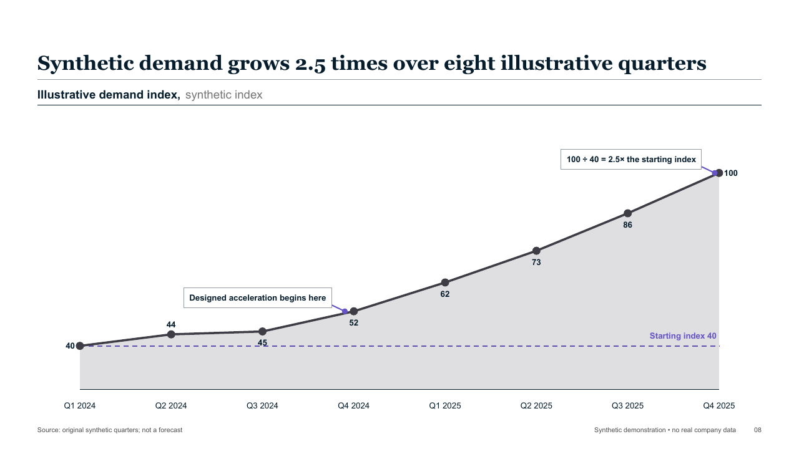
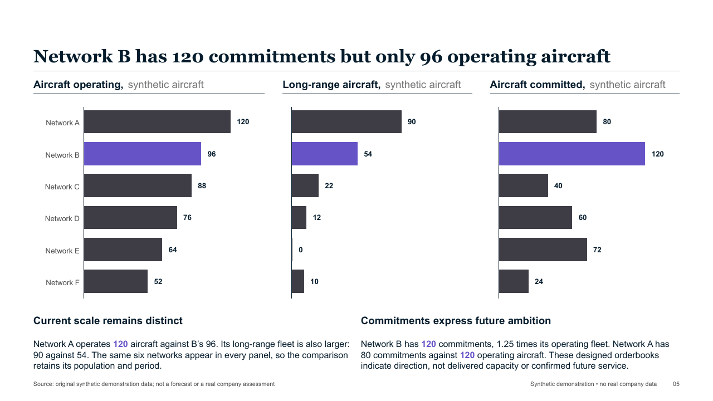

# Professional Slides

An AI skill for planning, creating, and revising editable PowerPoint decks. Start with a brief, analysis, or existing presentation; approve the storyline; then build and review the saved file.

Built for board papers, project updates, pitches, due diligence, and strategy decks. Runs in Codex or Claude Code with a local authoring runtime.

[Explore the gallery](https://shiphappens.xyz/slides) · [Download a sample deck](https://shiphappens.xyz/professional-slides/decks/british-airways-europe.pptx) · [Read the skill](skills/professional-slides/SKILL.md#pipeline)



## Why use it

- **Develop the argument first.** Define the audience's question, governing answer, evidence, and slide titles before layout.
- **Keep evidence traceable.** Use supplied sources or public research; separate facts from assumptions and flag missing evidence.
- **Keep the deck editable.** Text, tables, and diagrams remain PowerPoint objects. Eligible charts use native charts with embedded workbooks; custom treatments use editable grouped shapes.
- **Review the saved output.** Render the actual PPTX, check layout and claims, and run an independent review before delivery.

## What it can build

The [authoring catalogue](skills/professional-slides/runtime/page-types.mjs) contains **20 page families and 94 forms**, backed by **106 registered components** in the [component registry](skills/professional-slides/runtime/registry.mjs).

| Coverage | Forms | Examples |
| --- | ---: | --- |
| Charts | 30 | Trends, rankings, shares, scatter and bubble charts, waterfalls |
| Tables, scorecards, and metrics | 17 | Data tables, findings matrices, heatmaps, progress views, metric strips |
| Processes and structures | 16 | Flows, trees, funnels, cycles, frameworks, Sankey diagrams |
| Plans and schedules | 4 | Timelines, Gantt charts, roadmaps, horizons |
| Comparisons and profiles | 12 | Options, parallel arguments, company profiles, people, radar charts |
| Narrative and summaries | 6 | Executive summaries, takeaways, memos, statements, quotations |
| Pictures and maps | 5 | Hero images, picture pairs and strips, photo backdrops, maps |
| Multi-exhibit panels | 4 | Rows, grids, stacks, sequences |

Shared components add covers, dividers, contents, trackers, logos, icons, and source notes. Print the full catalogue with:

```bash
node skills/professional-slides/runtime/author-deck.mjs --types
```



These examples use synthetic data. See more forms in the [live gallery](https://shiphappens.xyz/slides).

## Start with a brief

Invoke `$professional-slides` in Codex or `/professional-slides:professional-slides` in Claude Code, then give it a brief like this:

```text
Create a 12-slide board deck from the attached analysis.
Audience: the board.
Decision: which retention initiative to prioritize next quarter.
Evidence: use only the supplied files and flag gaps.
Style: consulting, using our reference deck as the house style.
First propose the storyline and slide titles for review.
```

The workflow is **evidence → storyline → approval → slides → rendering → review**. It asks for missing design choices and pauses for storyline approval. You can also request just the storyline or titles.

Revisions create a new PPTX and preserve the original; point changes carry unrelated source slides into the new file. For quick typos, colours, or fonts, use a general PowerPoint editor.

## Choose the design

| System | Best suited to |
| --- | --- |
| `consulting` | Boards, steering committees, diligence, compact evidence |
| `editorial` | Narrative pre-reads, strategy papers, prose with imagery |
| `journal` | Chart-led briefings, full-width evidence, small multiples |
| `keynote` | Live pitches, launches, larger type, one idea per page |

A reference deck, website, or brand colours can guide the house style. [Design preferences](skills/professional-slides/references/theming.md) are saved for later work. [Story templates](skills/professional-slides/references/templates/index.md) cover diligence, competitive positioning, startup pitches, and project updates.

## Install and start

Use Node 20.9+ and a signed-in agent CLI. The environment check identifies missing Python packages, a slide renderer, and poppler, and prints install commands and the recommended `RUNTIME_PYTHON`. Rendering prefers installed desktop PowerPoint on macOS and Windows; LibreOffice is the fallback and the Linux renderer. PowerPoint needs activation and local automation access. LibreOffice is optional when PowerPoint is available.

```bash
git clone https://github.com/96imranahmed/professional-slides.git
cd professional-slides
node skills/professional-slides/runtime/doctor.mjs
python3 evals/scripts/package_plugin.py
```

After the environment check passes, the package is in `dist/professional-slides`:

- **Codex:** add that directory to a [local marketplace](https://developers.openai.com/plugins/build/plugins#build-your-own-curated-plugin-list), install its `professional-slides` entry, and invoke `$professional-slides`.
- **Claude Code:** run `claude --plugin-dir dist/professional-slides`, then invoke `/professional-slides:professional-slides`.

Set `PROFESSIONAL_SLIDES_RENDERER` to `auto` (default), `powerpoint`, or `libreoffice` to choose a renderer. Explicit selections never fall back; automatic mode records the renderer used and any failed attempts. Use `libreoffice` for jobs without a desktop session. All renderers verify the saved PPTX through the same checks.

Keep outputs outside the installed plugin. See [environment details](skills/professional-slides/references/tools/production.md). Google Slides import needs its own visual check; inspect fonts, wrapping, crops, and charts after import.

<details>
<summary>Development and public submission</summary>

```bash
npm ci
npm run check
npm run package:plugin
npm run package:submission
```

The [evaluation guide](evals/README.md) covers rendered and agent checks. Technical checks alone do not establish a deck's argument or visual quality.

Public submission creates a separate skills-only ZIP using the [distribution README](submission/README-DISTRIBUTION.md), with manifest, file-hash, and integrity validation. Keep both listings synchronized and complete publisher verification, scans, and attestations in the portal. The hosted policy pages load [privacy](.codex-plugin/PRIVACY.md) and [terms](.codex-plugin/TERMS.md) from `main`.

</details>

## Support and contributors

[Report an issue](https://github.com/96imranahmed/professional-slides/issues) · [Privacy](https://shiphappens.xyz/slides/privacy) · [Terms](https://shiphappens.xyz/slides/terms)

- [Patrick O'Brien](https://github.com/psobrien)
